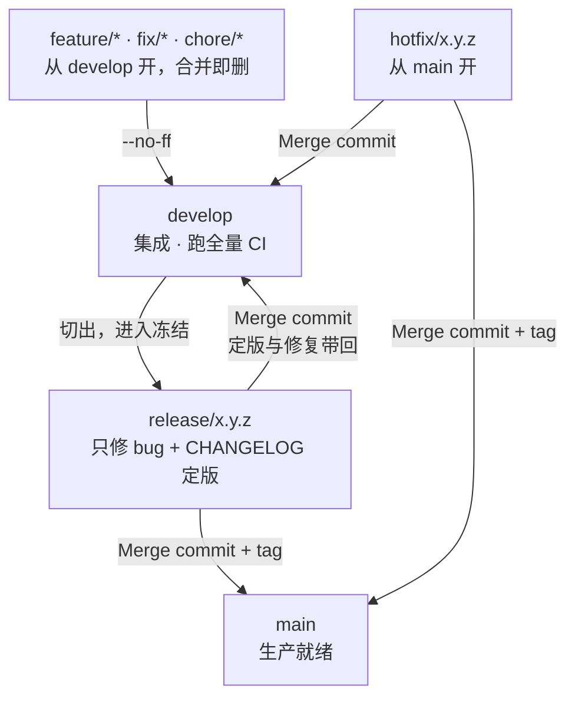
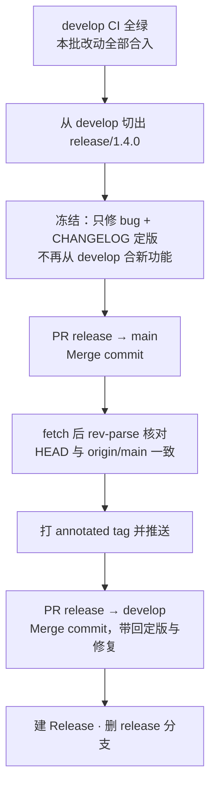

# 分支与协作规范

> 单人项目也需要规则：**规则的作用不是约束别人，而是让三个月后的自己（以及任何读到仓库的人）能一眼看懂当前处于什么状态。**

## 分支模型

本仓库遵循 **Git Flow**：两条长期分支（`main`、`develop`）加三类短命分支（`feature`、`release`、`hotfix`）。`main` 只接收合并，`develop` 是集成主干，「功能开发」「发版冻结」「线上救火」三条流互相隔离。



| 分支 | 从哪开 | 角色 | 谁能合进来 | 生命周期 |
|---|---|---|---|---|
| `main` | — | **生产就绪**。任何 commit 都应可发布，每次合入必打 tag | 只接受 `release/*` 与 `hotfix/*` | 永久 |
| `develop` | `main`（仅初始化时） | **集成**。功能在这里汇合、跑全量 CI | 只接受 `feature/*` `fix/*` `chore/*` 等短命分支 | 永久 |
| `feature/*` `fix/*` `chore/*` `refactor/*` `test/*` `docs/*` | `develop` | 新功能 / 修缺陷 / 依赖与 CI / 重构 / 补测试 / 文档 | — | 合并即删 |
| `release/x.y.z` | `develop` | **发版冻结**。只修 bug 与 CHANGELOG 定版，不再合新功能 | — | 双合后删除 |
| `hotfix/x.y.z` | **`main`** | 线上紧急缺陷 | — | 双合后删除 |
| `dependabot/*` | 平台自动（每周一，基于 `develop`） | 依赖升级，按 `chore` 语义对待 | — | 合并即删 |

开分支前先同步，否则起点是旧的、PR 会莫名冲突：

```bash
git switch develop && git pull --ff-only
git switch -c feature/<短横线描述>
```

两类例外：`release/*` 从 `develop` 切出**后不再从 `develop` 合入新功能**（这就是「冻结」）；`hotfix/*` 必须基于 `main` 的当前状态，否则修的不是线上那份代码。

## 命名规则

```
<type>/<短横线描述>
```

`type` 用 Git Flow 的辅助分支前缀，与 Conventional Commits 的提交 type 一一对应（唯一差别是 `feature` 在提交里写作 `feat`）：

| type | 用于 | 例子 |
|---|---|---|
| `feature` | 新增能力 | `feature/totp-recovery-codes` |
| `fix` | 修缺陷 | `fix/refresh-token-replay-window` |
| `chore` | 依赖升级、CI、构建配置 | `chore/net10-upgrade` |
| `refactor` | 不改行为的结构调整 | `refactor/split-token-service` |
| `perf` | 只改性能不改行为 | `perf/remove-sync-blocking` |
| `style` | 格式与注释整理，零行为变化 | `style/comment-slimming` |
| `docs` | 纯文档 | `docs/deployment-notes` |
| `test` | 纯测试补充 | `test/mfa-channel-coverage` |

要求：

- 全小写、用短横线分词，不出现中文、下划线、大写字母
- 描述**说清做什么**，不要 `fix/bug`、`feature/update` 这种无信息量的名字
- 一个分支只做一件事。混合改动会让 review 和回滚都变难

`release/*` 与 `hotfix/*` 例外——它们用**语义化版本号**而不是描述，因为一条分支就对应一个已确定的版本：

```bash
release/1.4.0
hotfix/1.4.1
```

点分三段、不带 `v` 前缀（`v` 只出现在 tag 上，如 `v1.4.0`）。

## 代码注释

注释只写「删掉它读者就会做出错误修改」的内容。写之前先过一遍这个标准，过不了就删。

| 位置 | 形态 | 要求 |
|---|---|---|
| 类型头 `<summary>` | 一句话 | 说清"这是什么"，设计展开留给 `<remarks>` 或 docs/ |
| 类型头 `<remarks>` | 短行列表，3-6 条 | 只收不写就会丢的 why：扩展缝选择、失效/并发/降级承诺、与上游行为的差异 |
| 成员 XML 注释 | 一行 | 含义不显然才写 |
| 行内 `//` | 1-2 行 | 只留"为什么这么做"；删掉叙事铺陈（"否则会……表现为……很难查"式排比） |
| `// ---- X ----` 分节 | 保留 | 文件内职责分界的导航，各分节名与文档分工一致 |

硬约束：

- 不写多段散文；一行注释说一件事，说完就停
- 同一信息注释与 docs/ 都有时，注释只留一句并指向文档
- 不复述代码已经表达的事（方法名、类型名能看出来的不注释）
- 示例标杆：`RedisCachedTokenStore`、`OpenApiExtensions`（remarks 列表式）与 `AccountService` 分部文件（行内式）

## 提交信息

遵循 [Conventional Commits](https://www.conventionalcommits.org/)，与分支 type 对齐：

```
<type>(<可选 scope>): <祈使句描述>

<可选正文：为什么改、权衡了什么>
```

实际例子（本仓库历史）：

```
chore: 升级到 .NET 10（LTS）与 OpenIddict 7.7.2
fix(build): 显式引用 System.Security.Cryptography.Pkcs 10.0.13
ci: SDK 固定到 10.0.x（net10.0 无法用 9.x SDK 编译，NETSDK1045）
```

避免 `update`、`修复一下`、`1` 这类提交信息——**提交历史是给人读的，不是给 git 读的**。

## 合并方式

Git Flow 全程使用 **merge commit（`--no-ff`）**，任何方向都不使用 squash：

| 方向 | 方式 | 说明 |
|---|---|---|
| 功能分支 → `develop` | Merge commit | 保留功能内部的分步提交，`git bisect` 才能定位到「功能里哪一步」 |
| `release/*` → `main` | Merge commit + tag | tag 打在 merge commit 上，`git log --first-parent main` 就是发布节奏 |
| `release/*` → `develop` | Merge commit | 把冻结期的 bug 修复与定版带回集成主干 |
| `hotfix/*` → `main` | Merge commit + tag | 同 `release` |
| `hotfix/*` → `develop` | Merge commit | 不带回的话，下个 release 会复发同一个 bug |

**为什么不用 squash**：squash 的收益是主干线性、一个功能一个提交；代价是功能内部的提交全部消失，`git bisect` 只能定位到「整个功能」，定位不到「功能里的哪一步」。而在 Git Flow 里这个收益并不必要——**`develop` 本来就是允许杂乱的集成分支，主干的干净是由 `release` 冻结后合入 `main` 保证的，不靠 squash 保证**。

**为什么 tag 必须落在 merge commit 上**：用 squash 合并 `release/*` 会生成一个只有单父的普通提交，`main` 上就不存在「发布边界」，tag 也挂在一条与 `release` 分支无血缘关系的新提交上——「这个功能是哪个版本进来的」只能翻 CHANGELOG。自检：`git log -1 --format=%p <tag>` 应输出**两个**父提交。

**为什么 hotfix 必须双合**：只合 `main` 的话，`develop` 上没有这次修复，下个 release 会把它重新带回线上。双合之后，`develop` 一旦包含该 merge，就从祖先关系上确认了修复已回流。

PR 合并时 GitHub 会自动删除 head 分支（仓库已开启 `delete_branch_on_merge`），不需要手工清理。

## 发布流程

顺序不能换：**先切 `release` 冻结定版，再合 `main`，然后打 tag，最后合回 `develop`**。tag 一旦推送不可逆，所以它必须在流程后段。



```bash
# 1. develop CI 全绿，切出 release 分支，进入冻结
git switch develop && git pull --ff-only
git switch -c release/1.4.0
git push -u origin release/1.4.0

# 2. 冻结期只做两件事：修 bug、写 CHANGELOG 定版
#    不要再从 develop 合新功能 —— 那会让发版内容不可控、回归范围失控
#    ……改 CHANGELOG.md、修冻结期发现的 bug……

# 3. PR：release/1.4.0 → main，合并方式 Merge commit

# 4. 打 tag 前核对：本地 HEAD 是否真的等于远端 main
git switch main
git fetch origin
git pull --ff-only
git rev-parse HEAD          # 必须等于下一行，否则停下排查
git rev-parse origin/main
git tag -a v1.4.0 -m "v1.4.0: <一句话说明>"
git push origin v1.4.0

# 5. PR：release/1.4.0 → develop，合并方式 Merge commit
#    把冻结期的修复与定版带回集成主干，然后删除 release 分支

# 6. 在 GitHub Releases 里基于该 tag 写发布说明（必须写「升级到本版本要做什么」）
#    只保留当前版本，旧 Release 删除但保留 tag
```

**为什么定版必须在 `release` 分支上做**：定版是「冻结期的动作」，`release` 分支的语义就是「这一版只做这些事」。定版若脱离冻结期提前完成，`develop` 上就会长期挂着一个尚未发布的版本号，而实际发版内容还可能变。

**为什么第 4 步要显式核对 HEAD**：`git merge --ff-only origin/main` 在本地 tracking ref 陈旧时会返回「已是最新」并退出 0，看起来一切正常，实际上 tag 打在了旧提交上——这类错误不会报错，只会让 tag 静默指向错误位置。判断「本地已是最新」不能依赖 `--ff-only` 的返回码，必须用 `rev-parse` 做字符串比对。

**Release 与 CHANGELOG 的分工**：Releases 上只挂当前版本，历史版本一律以
[`CHANGELOG.md`](CHANGELOG.md) 为准——发布页不适合当版本档案，翻历史要一路滚。

**CHANGELOG 条目随功能走**：功能 PR 合入 `develop` 时就顺手在 [`CHANGELOG.md`](CHANGELOG.md)
的「未发布」段写条目，只描述做了什么、不写版本号。冻结期只做两件事：把「未发布」改名成
本版版本号、补「升级到本版本要做什么」。发版时靠回忆整版改了什么，必然遗漏。

**版本号**（语义化）：破坏性变更 → major；向后兼容的新能力 → minor；仅修复 → patch。
数据库迁移属于破坏性变更的强信号，走 major。

**冻结期有多长**：只有一个版本要发、CI 全绿的前提下，通常就是「写完 CHANGELOG 到合入 `main`」这几十分钟。它不需要是一个真实的时间窗口，它的作用是**在流程上隔开「还在变」和「不再变」两种状态**。

**发版后不需要「回灌 `main` → `develop`」**：旧流程（`develop` → `main` 直发）曾靠回灌 PR 把 main 的发布 merge 带回 develop。新流程里 `release → develop` 这一步已经带回全部内容；`main` 上的 merge commit 永远不会出现在 `develop` 的祖先里，`git rev-list develop..main` 永远非空、GitHub 会一直显示「main 领先 develop」——这是 Git Flow 的正常形态，不是遗漏，不要再开回灌 PR。

## 紧急修复（hotfix）

线上出问题时不走 `develop`，直接从 `main` 拉救火分支。修完**必须双合**，否则下个 release 会把同一个 bug 带回来。

```bash
# 1. 从 main 当前状态开分支（否则修的不是线上那份代码）
git switch main && git pull --ff-only
git switch -c hotfix/1.4.1

# 2. 修复、提交，PR → main（Merge commit，禁止 squash），CI 必须绿
# 3. 核对后打 patch tag（同发布流程第 4 步：先 fetch，再 rev-parse 比对）
git tag -a v1.4.1 -m "v1.4.1: <一句话说明>"
git push origin v1.4.1

# 4. 双合：PR hotfix/1.4.1 → develop，Merge commit
#    若此刻存在 release 分支，也要把它合进那条 release 分支
```

顺序是 **修复 → 进 `main` → 打 patch tag → 合回 `develop`**。tag 放在合回 `develop` 之前，是因为 tag 必须指向 `main` 上那个 merge commit——它才是「线上这一版」。

同一个 bug 如果已经在 `develop` 上被独立修过，`hotfix` 合回时会产生冲突，**按 `main` 的版本解**，因为线上那份是被验证过的。

## 分支保护

| 规则 | `main` | `develop` |
|---|---|---|
| 禁止直接 push | ✅ 只走 PR | ✅ 只走 PR |
| 禁止 force push | ✅ | ✅ |
| 禁止删除分支 | ✅ | ✅ |
| 合并前 CI 必须绿 | 编译与测试 / 镜像构建校验 / 依赖漏洞检查 / 静态分析 | 编译与测试 |
| 要求分支与目标同步（up-to-date） | ❌ | ❌ |
| 要求人工 approve | ❌（单人项目无法自我 approve） | ❌ |

**为什么 `main` 也不要求 up-to-date**：Git Flow 的两条主干天然会分叉——`release/*` 合进 `main` 产生 merge commit，而这条 merge commit 不在 `develop` 上。强制 up-to-date 会逼出一个 Git Flow 里并不存在的反向同步步骤——每次发版后都得先把 `main` 合回 `develop`，才能开下一个 release PR。而这道保护本身收益有限：GitHub 的 PR CI 跑的就是「合并后」的 merge ref，合入前已经测过合并结果，不存在「没测过就合进去」。

**tag 也在保护范围内**：针对 `v*` 配置 tag ruleset，禁止删除与更新。「tag 一旦推送不可逆」这句话靠的不是自觉而是平台强制——没有 tag ruleset，误删或覆盖 tag 都不会报错，只有发版后才会发现。

> 分支保护是**兜底**，不是替代自觉。它拦住的是「凌晨三点着急修 bug 直接 push main」这类失误。

## 日常命令

```bash
# 删掉远端已删除分支的本地追踪引用（每周做一次，避免 `git branch` 越列越长）
git fetch --prune

# 查看哪些本地分支已合并进 develop，可以安全删除
git branch --merged develop

# 批量清理已合并的本地分支（保留 main / develop）
git branch --merged develop | grep -v -E '^\*|main|develop' | xargs -r git branch -d
```

## 反模式清单

| 做法 | 为什么不行 |
|---|---|
| 长期不合并的功能分支 | 合并冲突随时间指数增长，最后只能推倒重来 |
| 一个分支跨多个需求 | review 无法聚焦，出问题无法只回滚其中一个 |
| 直接 push `main` | 绕过了 CI，`main` 的「可发布」承诺失效 |
| 用 `master` / `dev` / `development` 等别名 | 命名不统一 = 每个新项目都要重新猜 |
| 依赖分支长期堆积不处理 | 本仓库曾积压 10 个 Dependabot PR（其中 3 个升同一个包），基线停在旧版本，全部作废 |
| 对任何分支用 squash 合并 | 功能内部提交消失，`git bisect` 只能定位到整个功能；`main` 上还会失去发布边界，tag 挂在无血缘的新提交上 |
| `release` 切出后再从 `develop` 合入新功能 | 冻结失效，发版内容不可控、回归范围扩大、发布日期不可预测 |
| `hotfix` 只合 `main` 不合 `develop` | 下个 release 会把同一个 bug 重新带回线上 |
| 在功能分支里写 CHANGELOG 版本号 | 版本号是冻结时才确定的事实；写在功能分支会让 `develop` 长期挂着「未发布」的版本说明 |
| 打 tag 前不核对 `origin/main` | `--ff-only` 在 tracking ref 陈旧时会假装成功，tag 落在旧提交上；tag 一旦推送就不能改 |
| `release` 分支上顺手加个小功能 | 「只是小改动」是冻结失效最常见的入口；要么进下个 release，要么承认这次发版范围变了 |
| 发版后再开「回灌 `main` → `develop`」的 PR | `release` → `develop` 已带回全部内容；`main` 的 merge commit 不进 `develop` 历史是 Git Flow 正常形态，回灌只会制造空噪音 PR |
